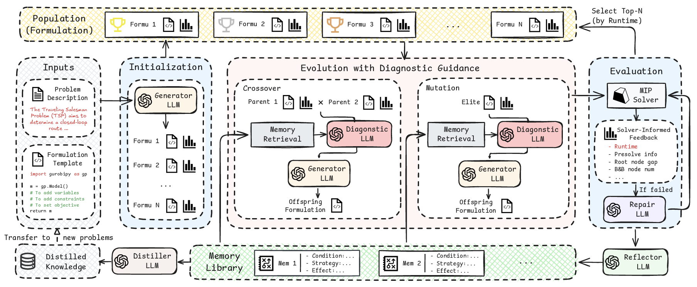

# FormuEvo

Our paper **[FormuEvo: LLM-Guided Evolution for Discovering Solver-Efficient Mixed-Integer Programming Formulations](https://arxiv.org/abs/2608.23353v1)** has been accepted to **EMNLP 2026**.

**FormuEvo** is an LLM-guided evolutionary framework for automated discovery of solver-efficient MIP formulations. It iteratively generates, evaluates, and selects candidate formulations guided by solver-informed diagnosis and structured memory toward better solver efficiency.

<p align="center">
  <a href="https://arxiv.org/abs/2608.23353v1">
    
  </a>
</p>

## Features

- Support LLMs: OpenAI, OpenRouter, Google Gemini, and DeepSeek.
- Support problems `tsp`, `jssp`, `bpp`, `cflp`, `qap`, `nnv` and `imo`.
- Support parallel generation and evaluation across CPU cores (only on Linux now).

## Repository Layout

```text
.
├── configs/
│   ├── llm_api.json      # API and Gurobi credential template
│   └── run_cfg.json      # Run configuration
├── problems/
│   ├── eval.py           # Shared evaluation utilities
│   └── <problem>/        # Problem-specific inputs and evaluators
├── prompts/              # System prompts for each evolution stage
├── evolution.py          # Core evolutionary loop
├── llm_caller.py         # Provider-specific LLM wrapper
├── main.py               # Main entry point
└── run_evo.sh            # Example Slurm submission script
```

## Requirements

- Python 3.10+
- Gurobi with valid credentials
- Python packages:
  - `openai`
  - `google-genai`
  - `numpy`
  - `scipy`
  - `gurobipy`

Install dependencies manually or inside your own environment manager:

```bash
pip install openai google-genai numpy scipy gurobipy
```

## Configuration

### 1. LLM and Gurobi credentials

Edit `configs/llm_api.json` before running:

- Leave `openrouter_api`, `openai_api`, `google_api`, or `deepseek_api` empty if you prefer to provide them through environment variables.
- Replace `gurobi_api` with your own Gurobi WLS credentials.

Example environment variables:

```bash
export OPENAI_API_KEY="your-openai-key"
export OPENROUTER_API_KEY="your-openrouter-key"
export GOOGLE_API_KEY="your-google-key"
export DEEPSEEK_API_KEY="your-deepseek-key"
```

### 2. Run settings

Configure `configs/run_cfg.json`:

- `problem`: target problem name, such as `jssp` or `tsp`
- `provider`: `openai`, `openrouter`, `google`, or `deepseek`
- `model`: provider-specific model name
- `pop_size`, `max_iter`, `mut_rate`, `mem_rate`: evolution hyperparameters
- `timeout`: per-evaluation timeout in seconds
- `num_train`, `num_val`: numbers of training and validation instances

## Usage

Run locally:

```bash
python main.py
```

Run with Slurm:

```bash
bash run_evo.sh
```

Before using `run_evo.sh`, replace the placeholder values for partition, account, QOS, node list, and email with settings valid for your cluster.

## How It Works

1. Loads a seed formulation and problem description.
2. Evaluates the seed and builds the initial population.
3. Uses diagnosis prompts to prepare crossover and mutation requests.
4. Repairs invalid code when execution fails.
5. Evaluates new candidates and keeps the best formulations.
6. Reflects on successful offspring and updates a memory library.
7. Runs a final validation pass and saves the best formulation.

## Outputs

Each run creates a timestamped directory under `outputs/<problem>/` containing:

- generated responses
- candidate code snapshots
- execution logs
- `evolution.log`
- `final_code.txt`
- `final_memory.txt`

## Citation

If you find FormuEvo useful for your research, please consider giving this repository a star and citing our paper:

```bibtex
@inproceedings{yuan2026formuevo,
  title = {{FormuEvo}: {LLM}-Guided Evolution for Discovering Solver-Efficient Mixed-Integer Programming Formulations},
  author = {Yuan, Haofeng and Peng, Jianing and Bi, Jieyi and Zhang, Ni and Song, Shiji and Cao, Zhiguang},
  booktitle = {Proceedings of the 2026 Conference on Empirical Methods in Natural Language Processing},
  year = {2026},
  pages = {5109--5135},
  doi = {10.18653/2026.emnlp-main.221}
}
```
